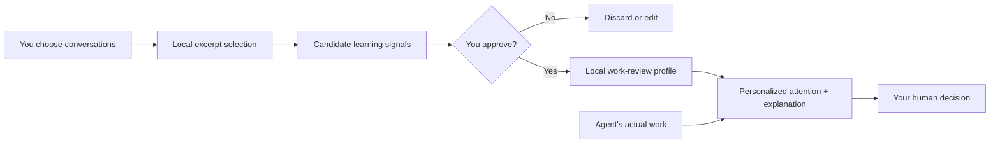
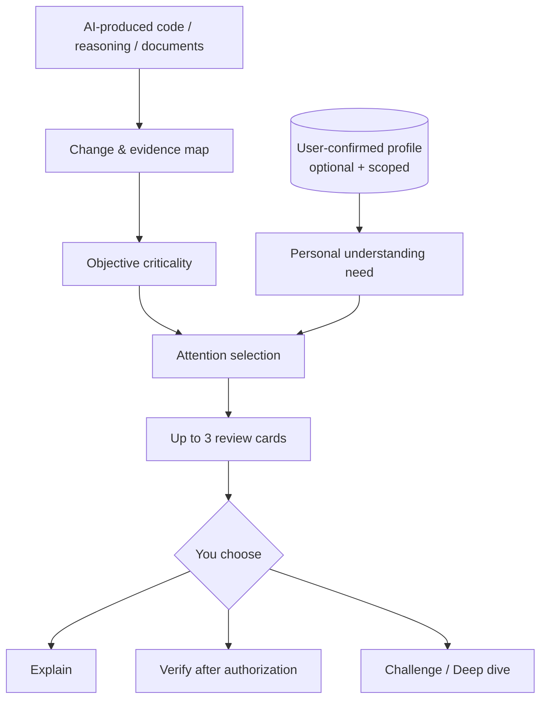

<div align="center">

# MARIS
### **Less output. More understanding. Better decisions.**

**Memory-Aware Review & Insight Skill** — personalized human oversight for AI agents, during work and after delivery.

Your agent can change a thousand lines. MARIS helps you find the **three decisions you need to understand**, and flags high-impact decisions **while the agent works** — with evidence, uncertainty, and explanations tailored to *you*.

[English](README.md) · [简体中文](README.zh-CN.md) · [Quick start](#quick-start) · [Personalization](#your-history-your-call) · [How it works](#how-maris-works) · [Security](SECURITY.md)

[](https://agentskills.io/specification)
[](LICENSE)
[](skills/maris/scripts/profile.py)
[](docs/PRIVACY.md)
[](docs/PRIVACY.md)

</div>

---

> **The comprehension gap.** AI agents create results faster than people can inspect them. A summary tells you what happened. **MARIS helps you decide what deserves your attention — with real evidence, uncertainty, and optional user-approved context.**

## Three evidence-backed demos: Understand · Verify · Decide

[**中文三案例总览 →**](demos/README.zh-CN.md) · [Detailed English guide →](demos/README.md)

No invented “agent did 2,000 lines” claims. Here are three concrete tasks with sources you can inspect, local checks you can run and profile-aware **reference** explanations you can challenge.

| Demo | Real task and evidence | Human attention MARIS should prioritize |
|---|---|---|
| **01 — [Coding: RevAgent](demos/01-coding/README.md)** | [Actual history-memory commit](https://github.com/chenyongssss/revagent/commit/42ab1cb4488051a6c4066b3053deea548d47be27) and its [later retention fix](https://github.com/chenyongssss/revagent/commit/40b48733b1d8e9b0641dbb750c488b1f77bae2f1) | A `30_days` policy was *recorded* before expiry behavior was added; the contract mattered more than line count. |
| **02 — [Research: Poisson](demos/02-research/README.md)** | [Exact arithmetic counterexample](demos/02-research/evidence/poisson_checker.py), verified locally | Four identical point samples do not imply full-state uniqueness; exact open-set unique continuation is a different assumption. |
| **03 — [Decision: Open engineering software](demos/03-decision/README.md)** | [FMI / CAD / EDA public source ledger](demos/03-decision/evidence/source-ledger.json) and transparent [sensitivity calculator](demos/03-decision/evidence/score_options.py) | Ask which user and team you serve before choosing between open-standard simulation, CAD exchange and EDA flow. |

**Run the local evidence checks (no API keys):**

```bash
python demos/run.py --verify
python demos/run.py --case coding   --mode personalized
python demos/run.py --case research --mode personalized
python demos/run.py --case decision --mode personalized
```

> **Transparent evaluation status:** the baseline / cold-start / personalized Markdown outputs are **curated reference briefs**, not measured AI Agent outputs. The first demo analyzes verified historical source changes, the second includes an executed exact-math proof check, and the third uses real technical sources with **hypothetical** decision weights. We have not yet measured any improvement in real user comprehension. [Full methodology →](demos/EVALUATION.md)

## 20-second demo

From the real RevAgent history commit: **“30 days” was saved as a policy, but the original module did not yet enforce expiry.** A later commit added retention checks before indexing, searching and exporting.

**Ordinary summary (illustrative, not an actual model run):**

> “Added consent-gated history import, redaction, full-text search and deletion.”

**MARIS target output (evidence-audited, not an actual model run):**

```text
MARIS BRIEF  |  Profile: optional  |  Source: pinned public commits

01  MUST VERIFY: the 30-day deletion promise
    OBSERVED: policy is persisted; expiry is absent in the historical module.
    OBSERVED: a later change implements expiry + a regression test.
    YOU NEED: distinguish saving a retention choice from enforcing it.
    NEXT: check 29 / 30 / 31-day boundaries before accepting the feature.

02  MUST VERIFY: consent and redaction are independent gates
    OBSERVED: approval and preview hashing protect separate properties.
    UNKNOWN: whether all sensitive information is covered by redaction.

Explain #1  ·  Verify #1  ·  Challenge #1
```

For an expert Python developer learning privacy semantics, MARIS should discuss **temporal invariants** rather than teach Python basics. No expertise signal can hide an objectively critical item. [Inspect source, reference answers and provenance →](demos/01-coding/README.md)

## Quick start

After the public repository `chenyongssss/maris` is created:

```bash
npx skills add chenyongssss/maris --skill maris
```

The installer is maintained by **skills.sh**, not by MARIS; it may have its own anonymous installation telemetry ([details](https://www.skills.sh/docs/cli)). MARIS's own scripts do not transmit data.

Or manually copy the entire `skills/maris/` directory into your host's supported Skills path (`.claude/skills/maris/` for a Claude Code project or `.agents/skills/maris/` for a Codex project). Reload the host if needed.

Then ask your agent:

```text
Use MARIS to review what you just did in this repository.
Show me what I must understand or verify before accepting it.
Be evidence-based. Do not edit files.
```

Some hosts expose `/maris` or `$maris`; exact invocation differs by host. Natural-language invocation works when the Skill has been discovered by the host.

**No account, API key, database or history import required for the core review.** You need an Agent Skills-capable host with access to the specific artifact. Python 3.10+ is only needed for optional local profile lifecycle commands.

## Stay in the loop *while* your agent works

You do not have to wait for a giant final diff. In an Agent Skills-capable host, invite MARIS to guide the **same active task**:

```text
Use MARIS in flow mode while implementing this feature.
Keep working autonomously on routine steps; interrupt me only when
a design assumption changes, important verification is missing,
or a high-impact decision requires my approval.
```

MARIS then uses short **decision checkpoints**, not a running commentary. Ask for `quiet`, `balanced` (default), or `learning` mode. It **does not** claim background monitoring or automatic interception of other agents: the current host must keep the Skill active in its own session.

## What makes MARIS different?

| Ordinary summary | Generic code review | **MARIS** |
|---|---|---|
| Lists what happened | Looks for defects | **Finds what the human should understand, verify or decide** |
| Same explanation for everyone | Primarily code-centered | **Adapts explanation to a user-reviewed cognitive profile** |
| Often repeats an agent's claims | May report issue likelihood | **Marks observed evidence, reported claims, inference and unknowns separately** |
| Ends with a report | Ends with a defect list | **Lets the human choose Explain / Verify / Challenge** |

MARIS is **not** a theorem prover, a security certification tool, or a complete substitute for domain expert review. It does not claim to have inspected anything outside the permitted context.

## Your history. Your call.

**Personalization is optional and off by default.** MARIS does not silently search chat histories. Instead it turns *selected, consented* previous conversations or manually stated preferences into a **draft cognitive profile** that you can inspect, correct and approve.



Your profile can express things like:

- **Familiar:** numerical PDEs — skip basic PDE introductions.
- **Learning:** authentication and cloud deployment — explain relevant security assumptions.
- **Review preference:** prioritize mathematical invariants, missing tests and unsupported claims.

The profile does **not** presume that mentioning a topic proves mastery. Each signal needs a source/basis and user confirmation. No personality diagnosis, relationship profiling, broad surveillance or social matchmaking.

### Import only selected conversations (optional)

MARIS includes a dependency-free local helper. It can read user-selected ChatGPT `conversations.json` or ZIP exports and user-provided `.md`/`.txt` transcripts. **No automatic account access or automatic whole-history import.**

Run from the project you want to review:

```bash
# 1. Inspect available titles/counts without printing message text
python /path/to/skills/maris/scripts/profile.py catalog --input /path/to/conversations.json

# 2. ONLY after you decide exactly which conversations MARIS may use:
python /path/to/skills/maris/scripts/profile.py stage \
  --input /path/to/conversations.json --indices 2,5 --consent

# 3. Ask your host agent to propose a cognitive profile from the selected file,
#    then inspect/correct the suggested fields before saving anything.
python /path/to/skills/maris/scripts/profile.py template

# 4. AFTER reviewing .maris/private/profile-candidate.json and explicitly approving it:
python /path/to/skills/maris/scripts/profile.py approve \
  --confirm APPROVE-MARIS-PROFILE
```

**Important:** the helper parses and stores excerpts locally without network requests; however, **your AI agent's provider may receive selected excerpts when the agent reads them**. Obtain permission for *both* selecting the content and letting the host/model process it. The profile files are local and gitignored, **not encrypted**. For stricter privacy, use an offline host and local model. Read [Privacy & data flow](docs/PRIVACY.md) before importing sensitive data.

No export? No problem. Create a manual profile from explicitly supplied expertise and preferences, or simply run MARIS **without a profile**.

Inspect or remove local MARIS data at any time:

```bash
python /path/to/skills/maris/scripts/profile.py show
python /path/to/skills/maris/scripts/profile.py erase \
  --confirm DELETE-MARIS-LOCAL-DATA
```

The erase command deletes **only MARIS's local staged excerpts, candidate and profile files** in that workspace. It does not remove the original export or data retained by an external host/model provider.

## How MARIS works



This is a **human attention policy**, not a generic summarizer. Objective risk comes first: a critical security or correctness concern cannot disappear because the profile says you're an expert. Personalization adjusts explanation depth, not truth or risk.

MARIS's source-status vocabulary is explicit:

| Label | Meaning |
|---|---|
| `OBSERVED` | Directly visible in an inspected file, diff, equation or record |
| `REPORTED` | Claimed by an agent, user or log; not independently reproduced |
| `INFERRED` | Plausible implication that still needs verification |
| `UNKNOWN` | Not enough evidence to decide |

## Modes

| Ask MARIS | What happens |
|---|---|
| `Review this agent's work` | A concise evidence-backed decision map |
| `Use MARIS in flow mode` | In-session checkpoints at consequential decisions; low interruption |
| `Use my approved profile for this review` | Adaptive review focused on your verified preferences |
| `Build a profile from these selected chats` | Explicit consent → staged excerpts → editable proposal → approval |
| `Explain #1` | Task-linked explanation at your preferred depth |
| `Verify #2` | Smallest actionable check; no unattended execution |
| `Challenge #1` | Alternative assumptions, failure cases and counterarguments |
| `Without my profile` | Review without reading the local profile |

[Full usage guide →](docs/USAGE.md)

## Try the demo and evaluate it fairly

- [Synthetic before/after example](examples/before-after.md) — a decision-aware and profile-aware review, clearly fictional.
- [Sample conversation export](examples/sample-conversations.json) — fake data for testing the local importer.
- [Evaluation protocol](evals/README.md) — compare ordinary prompting, MARIS without profile, and MARIS with profile on the *same* tasks.
- [Run package and importer tests](tests/) — standard-library `unittest`, no account needed.

```bash
python -m unittest discover -s tests -v
```

**Status:** early public implementation. Package and importer behavior can be tested locally; review accuracy, real-world comprehension gains and host compatibility require independent evaluation. We do not publish invented benchmarks, user counts or claimed certifications.

## Privacy and security promises

**No built-in telemetry · No background watcher · No auto-history access · No silent profile persistence · Read-only review by default.**

Those are properties of the MARIS Skill and helper, *not* a guarantee about third-party installers, IDEs, model providers or host-agent permissions. Do not pass secrets or confidential third-party information to a model unless authorized. Private workspace files are ignored by Git, not encrypted. [Read the threat model →](SECURITY.md)

## Repository

```text
maris/
├── skills/maris/
│   ├── SKILL.md                  # The actual Agent Skill
│   ├── scripts/profile.py        # Opt-in local history/profile helper
│   ├── references/              # Attention, privacy & evidence rules
│   └── assets/                  # Output contract
├── examples/                     # Synthetic demonstrations and fake data
├── evals/                        # Outcome-based evaluation protocol
├── docs/                         # Usage, privacy, architecture
├── tests/                        # Package and importer tests
├── SECURITY.md
├── CONTRIBUTING.md
└── LICENSE
```

## Contribute

MARIS is a hypothesis tested in public: **AI should move faster without leaving human understanding behind.** Contributions that improve evidence integrity, attention policies, privacy or evaluation are more valuable than feature bloat. Read [CONTRIBUTING.md](CONTRIBUTING.md), or open an issue with a **sanitized, reproducible** case where the Agent missed a decision that mattered.

**License:** [MIT](LICENSE). The project is independent and not affiliated with OpenAI, Anthropic or other agent providers.
