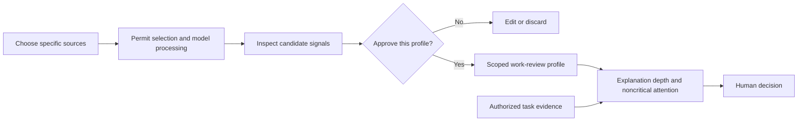
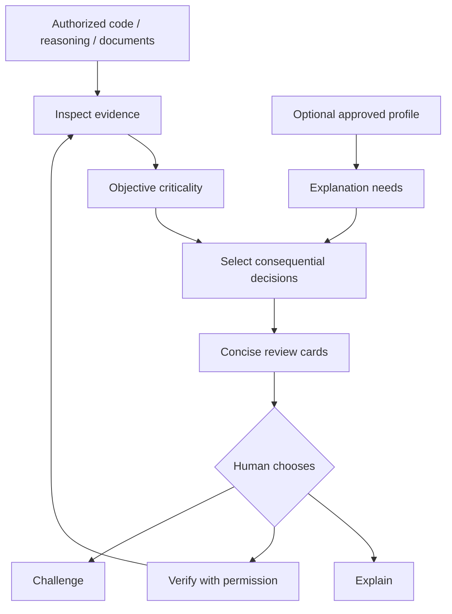

<div align="center">

# MARIS
### **Less output. More understanding. Better decisions.**

**Memory-Aware Review & Insight Skill** — personalized human oversight for AI agents, during work and after delivery.

MARIS helps you identify **the decisions you need to understand**, with evidence, uncertainty, and explanations tailored to your authorized task context. Flow mode supports checkpoints in the same active agent session, not background interception of other agents.

[English](README.md) · [简体中文](README.zh-CN.md) · [ChatGPT comparison](demos/CHATGPT_COMPARISON.md) · [Quick start](#quick-start) · [Personalization](#your-history-your-call) · [Security](SECURITY.md)

[](https://agentskills.io/specification)
[](LICENSE)
[](skills/maris/scripts/profile.py)
[](docs/PRIVACY.md)
[](docs/PRIVACY.md)

</div>

---

> **The comprehension gap.** AI agents create results faster than people can inspect them. A summary tells you what happened. **MARIS helps you decide what deserves your attention — with evidence, uncertainty, and optional user-approved context.**

## ChatGPT + MARIS: three workflow comparisons

**Coding, research and decision — two substantive review presentations for each task.**

| Case | Standard ChatGPT review | MARIS-guided review |
|---|---|---|
| Coding | Finds missing expiry checks and proposes boundary tests. | Turns the same finding into an acceptance gate and a precisely scoped verification plan. |
| Research | Constructs the harmonic counterexample to finite-sample uniqueness. | Preserves the proof and makes the manuscript acceptance/revision decision explicit. |
| Decision | Proposes only a conditional, reversible FMI experiment. | Separates reported facts, hypothetical scores and human approval before commitment. |

[**Read all six full responses and the shared task specifications →**](demos/CHATGPT_COMPARISON.md)

> **Non-blind, in-session demonstration—not an independent A/B benchmark.** Authored in the current ChatGPT session (model label: GPT-6 Astra Pro), already exposed to the answers and MARIS. The standard presentation is not an unexposed control. No separate Codex/API calls, no private-history import, and no measured accuracy, speed or learning claims. Both presentations retain the substantive findings.

## Three evidence-backed demos: Understand · Verify · Decide

[**中文三案例总览 →**](demos/README.zh-CN.md) · [Detailed English guide →](demos/README.md)

Three concrete tasks with inspectable sources, local checks and profile-aware reference explanations. These original references are separate from the in-session ChatGPT showcase above.

| Demo | Task and evidence | Human attention MARIS should prioritize |
|---|---|---|
| **01 — [Coding: RevAgent](demos/01-coding/README.md)** | [Actual history-memory commit](https://github.com/chenyongssss/revagent/commit/42ab1cb4488051a6c4066b3053deea548d47be27) and its [later retention fix](https://github.com/chenyongssss/revagent/commit/40b48733b1d8e9b0641dbb750c488b1f77bae2f1) | A `30_days` policy was recorded before expiry behavior was added; the contract mattered more than line count. |
| **02 — [Research: Poisson](demos/02-research/README.md)** | [Exact arithmetic counterexample](demos/02-research/evidence/poisson_checker.py), constructed for this demo | Four identical point samples do not imply full-state uniqueness; exact open-set unique continuation is a different assumption. |
| **03 — [Decision: Open engineering software](demos/03-decision/README.md)** | [FMI / CAD / EDA source ledger](demos/03-decision/evidence/source-ledger.json) and [sensitivity calculator](demos/03-decision/evidence/score_options.py) | Confirm the user and team before choosing an open-standard simulation, CAD exchange or EDA pilot. |

**Run local evidence checks (no API keys):**

```bash
python demos/run.py --verify
python demos/run.py --case coding   --mode personalized
python demos/run.py --case research --mode personalized
python demos/run.py --case decision --mode personalized
```

> **Evaluation status:** the original baseline / cold-start / personalized Markdown files are curated reference briefs, not measured agent outputs. `demos/run.py --case ...` replays those files. Coding analyzes historical source changes, research includes an executable exact-math check, and decision uses documented sources with hypothetical weights. Neither these checks nor the new ChatGPT presentation pairs establish a user-comprehension gain. [Methodology →](demos/EVALUATION.md)

## Quick start

Install from the public repository:

```bash
npx skills add chenyongssss/maris --skill maris
```

The installer is maintained by **skills.sh**, not MARIS; it may have its own installation telemetry ([details](https://www.skills.sh/docs/cli)). MARIS's local helper does not transmit data.

Or copy the entire `skills/maris/` directory into your host's supported Skills path: `.claude/skills/maris/` for a Claude Code project or `.agents/skills/maris/` for a Codex project. Reload the host if needed.

Then ask your agent:

```text
Use MARIS to review the authorized work in this repository.
Show what I must understand or verify before accepting it.
Give evidence locations. Use no history or profile.
Do not edit files or execute tests without my authorization.
```

Invocation differs by host; do not assume `/maris` is universal. Explicitly loading the reviewed Skill instructions in a ChatGPT conversation is a workflow demonstration, not proof that the native Skills loader or Codex integration has been tested.

**MARIS adds no model account of its own.** You still need a configured host and its normal access, authentication and permissions. Core review needs no history import or database; Python 3.10+ is needed for the optional local profile helper.

## Stay in the loop while your agent works

Invite MARIS to guide the **same active task**:

```text
Use MARIS in flow mode while implementing this feature.
Continue routine authorized work. Pause when a material assumption changes,
critical verification is missing, or an action needs my approval.
Do not treat silence as approval. Use no history or profile.
```

MARIS uses short decision checkpoints, not a running commentary. Ask for `quiet`, `balanced` or `learning` mode. It does not claim background monitoring or automatic interception of other agents: the host must retain the instructions in its own session.

## What MARIS is designed to add

A good ordinary review can already find defects and explain trade-offs. MARIS aims to make the human-facing workflow more consistent: consequential decision cards, explicit evidence states, a small next verification step, and optional user-controlled explanation depth. The [paired examples](demos/CHATGPT_COMPARISON.md) deliberately preserve the same core findings in the ordinary review.

MARIS is **not** a theorem prover, security certification tool, or substitute for domain expert review. It does not claim to inspect artifacts outside the permitted context.

## Your history. Your call.

**Personalization is optional and off by default.** MARIS does not silently search chat histories. It turns selected, consented conversations or manually supplied preferences into a draft cognitive profile that you can inspect, correct and approve.



A profile may express familiarity with numerical PDEs, a learning goal in authentication, or a preference for checking invariants and missing tests first. Each signal needs an explicit basis and user confirmation. Topic frequency is not proof of mastery. No personality diagnosis, relationship profiling or social matchmaking.

### Import selected conversations

The local helper accepts selected ChatGPT `conversations.json` or ZIP exports and user-provided Markdown/TXT transcripts. There is no automatic account access or whole-history import.

```bash
# Inspect titles/counts without printing message text.
python /path/to/skills/maris/scripts/profile.py catalog --input /path/to/conversations.json

# Only after the user chooses the conversations and authorizes staging.
python /path/to/skills/maris/scripts/profile.py stage \
  --input /path/to/conversations.json --indices 2,5 --consent

# Draft a candidate; inspect and correct it before approval.
python /path/to/skills/maris/scripts/profile.py template

# Only after explicit approval of .maris/private/profile-candidate.json.
python /path/to/skills/maris/scripts/profile.py approve \
  --confirm APPROVE-MARIS-PROFILE
```

**The helper selects and stores excerpts locally without network requests. Your host/model provider may receive selected text when the agent reads it.** Permission for local selection is not a substitute for permission to process that text with a model provider. Files are local and gitignored, not encrypted. Read [Privacy & data flow](docs/PRIVACY.md) before importing real history.

No export is needed for ordinary review. Manually supplied task preferences can be used without creating a saved profile.

```bash
python /path/to/skills/maris/scripts/profile.py show
python /path/to/skills/maris/scripts/profile.py erase \
  --confirm DELETE-MARIS-LOCAL-DATA
```

Erasure removes only MARIS's staged excerpts, candidate and profile in that workspace; it does not delete the original export or provider logs.

## How MARIS works



Objective risk comes first. A critical concern cannot disappear because the profile says the user is an expert. Personalization changes explanation depth, not truth or required verification.

| Evidence label | Meaning |
|---|---|
| `OBSERVED` | Directly inspected artifact; not automatically correct |
| `REPORTED` | Another party's claim, not independently established here |
| `INFERRED` | Analysis or implication, with its supporting premises and limits |
| `UNKNOWN` | Insufficient evidence to decide |

Evidence state and execution status are different. Reading a test log is not rerunning the test. The new showcase also distinguishes `GATE` (blocks acceptance), `FOCUS` (material review item) and `CONTEXT` (background). Its `NOT_RUN` means the named executable verification was not performed, not that no mathematical reasoning was supplied.

## Modes

| Request | Workflow |
|---|---|
| `Review this agent's work` | Evidence-linked decision brief |
| `Use MARIS in flow mode` | In-session checkpoints at consequential decisions |
| `Use my approved profile` | Scoped, authorized explanation personalization |
| `Build a profile from these selected chats` | Select → authorize → draft → review → approve |
| `Explain #1` | Task-linked explanation |
| `Verify #2` | Propose the smallest check; execution still needs authorization |
| `Challenge #1` | Alternative assumptions and failure cases |
| `Without my profile` | Review without reading a profile |

[Full usage guide →](docs/USAGE.md)

## Evaluate and contribute

[ChatGPT presentation pairs](demos/CHATGPT_COMPARISON.md) · [Original demo methodology](demos/EVALUATION.md) · [Evaluation protocol](evals/README.md) · [Synthetic conversation export](examples/sample-conversations.json) · [Contributing](CONTRIBUTING.md)

```bash
python -m unittest discover -s tests -v
```

Local tests verify package/helper behavior. They do not establish host compatibility, independent review accuracy or real-world comprehension gains. Fresh-session and user-level evaluation remain necessary; no invented benchmark, user count or certification is published.

## Privacy and security

**No built-in telemetry · No background watcher · No automatic history access · No silent profile persistence · Read-only review by default.**

These are MARIS workflow/helper boundaries, not a guarantee about third-party installers, IDEs, providers or host permissions. Private files are gitignored, not encrypted. [Security and reporting](SECURITY.md)

## Repository

```text
maris/
├── skills/maris/       # Skill, references, templates and profile helper
├── demos/             # Cases, checks and the labelled ChatGPT showcase
├── examples/          # Synthetic demonstrations and fake data
├── evals/             # Outcome-based evaluation protocol
├── docs/              # Usage, privacy and architecture
├── tests/             # Package and importer tests
├── SECURITY.md
├── CONTRIBUTING.md
└── LICENSE
```

MARIS is a hypothesis tested in public: **AI should move faster without leaving human understanding behind.** Submit sanitized, reproducible cases where a consequential decision was missed.

**License:** [MIT](LICENSE). Independent project; not affiliated with OpenAI, Anthropic or other agent providers.
