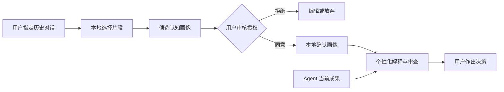

<div align="center">

# MARIS
### AI 高速工作，**你始终掌握关键。**

**Memory-Aware Review & Insight Skill** · 面向 AI Agent 的个性化认知协同与人工监督

AI 可以几分钟修改上千行代码；MARIS 帮你找到**真正需要理解、检查和决定的关键部分**，并在重要决策发生时提供适度交互。在获得授权后，还可以利用可校正的认知画像提供因人而异的解释。

[English](README.md) · [中文](README.zh-CN.md) · [快速开始](#快速开始) · [授权画像](#经授权的认知画像) · [隐私说明](docs/PRIVACY.md)

[](https://agentskills.io/specification)
[](LICENSE)
[](skills/maris/scripts/profile.py)
[](docs/PRIVACY.md)

</div>

---

> **AI 的产出速度，正在超越人的理解速度。** MARIS 不只是总结 Agent 做了什么，而是结合可信证据、当前任务和用户明确授权的知识背景，找出**真正需要理解、验证和决定的事情**。

## 三个真实任务：理解 · 验证 · 决策

[**中文三案例详细报告 →**](demos/README.zh-CN.md) · [English demos →](demos/README.md)

三个 Demo 分别建立在公开代码历史、可运行的数学反例和真实的工程软件技术资料之上，并公开给出输入、证据、对照说明和局限。

| Demo | 真实任务与证据 | MARIS 应该抓住什么 |
|---|---|---|
| **01 · [Coding：RevAgent](demos/01-coding/README.md)** | [真实历史提交](https://github.com/chenyongssss/revagent/commit/42ab1cb4488051a6c4066b3053deea548d47be27)及其[后续修复](https://github.com/chenyongssss/revagent/commit/40b48733b1d8e9b0641dbb750c488b1f77bae2f1) | 代码记录了 `30_days` 保留期限，但最初版本尚未实施到期清理；优先验证用户承诺。 |
| **02 · [Research：Poisson](demos/02-research/README.md)** | [精确有理数验证脚本](demos/02-research/evidence/poisson_checker.py)与数学推导 | “有限观测点”与“开子域连续观测”的唯一性假设不可混同。 |
| **03 · [Decision：工程软件路线](demos/03-decision/README.md)** | [FMI / CAD / EDA 官方资料台账](demos/03-decision/evidence/source-ledger.json)与[透明权重分析](demos/03-decision/evidence/score_options.py) | 在做路线选择前，先确认服务对象、团队能力与验收要求。 |

**无需 API Key，先运行可复核的本地验证：**

```bash
python demos/run.py --verify
python demos/run.py --case coding   --mode personalized
python demos/run.py --case research --mode personalized
python demos/run.py --case decision --mode personalized
```

**重要说明：** 三份 Demo 的 `baseline` / `cold-start` / `personalized` 文件是**基于证据人工编写的参考输出**，尚不是实际模型对照运行结果。Coding 复核历史版本中的真实实现差异；Research 已执行精确算术检验；Decision 使用官方文档，但权重与画像均为**假设示例**。不能据此宣称 MARIS 在真实用户中提升了多少效率。[评测规范](demos/EVALUATION.md)

## 看一个 20 秒真实代码案例

RevAgent 的一个历史版本新增了经授权的个人历史记忆：导入、脱敏、批准、索引和删除。在该历史提交中，`30_days` 仅作为保留策略被记录；后续提交才增加到期执行逻辑和相应测试。

**普通总结（示意，不是实测模型输出）：**

> “增加历史记录导入、脱敏、批准、搜索、导出、删除功能。”

**MARIS 的目标输出（基于真实代码证据整理）：**

```text
MARIS BRIEF  |  用户画像：可选  |  证据：固定的公开提交

01  必须验证：30 天保留期限是否真正执行
    已观察：历史版本写入 retention_rule，但缺少到期判断。
    已观察：后续修复增加到期清理逻辑与回归测试。
    你需理解：“存下期限”与“执行期限”是两件不同的事。
    下一步：检查第 29 / 30 / 31 天的索引与文件清理。

02  必须验证：授权不等于充分脱敏
    已观察：审核权限、文件哈希与脱敏是不同的机制。
    尚未知：脱敏规则是否覆盖实际历史中的所有敏感内容。

解释 #1 · 验证 #1 · 质疑 #1
```

对熟悉 Python、正在学习隐私生命周期的用户，优先说明**时间不变量与数据保留约束**，而非基础语法。无论用户是否自称专家，都不能隐藏关键风险。[查看可核实证据与完整对照 →](demos/01-coding/README.md)

## 快速开始

公开仓库 `chenyongssss/maris` 创建后：

```bash
npx skills add chenyongssss/maris --skill maris
```

`skills.sh` 安装器由第三方维护，可能收集匿名安装统计，和 MARIS 本身的零遥测是两回事。

也可以手动将 `skills/maris/` 复制到宿主支持的 Skill 目录，如 Claude Code 项目中的 `.claude/skills/maris/`，或 Codex 项目中的 `.agents/skills/maris/`。

安装后直接说：

```text
使用 MARIS 审查刚才 Agent 在这个仓库完成的工作。
只告诉我最需要理解、验证或作出决定的内容；
提供对应文件/证据，不要修改文件。
```

在支持的宿主里也可以显式调用 `/maris` 或 `$maris`（取决于客户端实现）。

**基础审查不需要历史数据、注册账号、API Key 或数据库。** 画像是自愿开启的增强功能，运行本地画像工具需要 Python 3.10+。

## 让 AI 工作时，也能按需介入

MARIS 不只用于任务完成之后。你可以在同一个 Agent 会话开始时要求：

```text
接下来用 MARIS 的 Flow 模式实现这个任务。
重复性工作可以自主完成；但当关键假设、风险、不可逆决策
或重要验证条件发生变化时，给我一个简短的 Checkpoint，
让我选择继续、验证还是调整。不要每一步都打断我。
```

提供 `quiet`（仅关键节点）、`balanced`（默认）和 `learning`（允许更多学习解释）三种交互强度。注意：这是**当前 Agent 会话的协作规范**，并不意味着一个 SKILL.md 能实时监视其他独立 Agent。后者需要专门的 Hooks / SDK 集成。

## 三个核心能力

| 能力 | 实际用途 |
|---|---|
| **关键注意力分配** | 从大量 Agent 产出中找出最多 3 项决定性变化，不按文件数量机械总结 |
| **证据与不确定性** | 将已观察到的事实、他人报告、风险推断和未知项严格分开 |
| **可选的个性化理解** | 参考经过用户确认的知识背景、学习目标及解释习惯，调整优先级与表达深度 |

MARIS 的目标是帮助人理解并审查复杂工作成果，而不是取代正式的安全审计、证明或领域专家验证。

## 经授权的认知画像

**默认不开启；绝不静默读取历史聊天。** 如果用户希望个性化，可以选择少量历史对话，让 MARIS 形成候选认知画像，并先让用户逐条审阅、修正，再决定是否保存。



画像示例：

- **熟悉**：PDE 数值离散（用户确认）→ 不再反复解释基础定义。
- **正在学习**：云部署和后端鉴权 → 遇到相关高影响变更时补充必要背景。
- **审查偏好**：优先标记未经验证的假设、实验复现风险和数学结构变化。

特别注意：用户过去频繁提到一个领域，不等于用户已经掌握该领域。画像不能包含由系统擅自推断的敏感身份、情感关系或人格诊断。

### 如何选择导入历史

支持经授权的 ChatGPT `conversations.json` 或 ZIP 导出，以及人工整理的 Markdown/TXT 对话文件；**不支持偷偷读取任何平台的全部会话**。

```bash
# 1. 只浏览对话标题和数量；不显示聊天正文
python /path/to/skills/maris/scripts/profile.py catalog \
  --input /path/to/conversations.json

# 2. 用户明确选择第 2、5 条对话后，在本地暂存选定内容
python /path/to/skills/maris/scripts/profile.py stage \
  --input /path/to/conversations.json --indices 2,5 --consent

# 3. 要求 Agent 在用户允许读取选定片段后生成画像草稿，并人工检查
python /path/to/skills/maris/scripts/profile.py template

# 4. 用户确认候选文件 .maris/private/profile-candidate.json 后才保存
python /path/to/skills/maris/scripts/profile.py approve \
  --confirm APPROVE-MARIS-PROFILE
```

本地解析脚本不会主动联网或上传内容。但**当宿主 Agent 读取这些片段时，数据可能发送给该宿主所使用的模型提供商**，因此需另行告知并取得同意。临时片段与画像存放在工作区 `.maris/private/`（Git 忽略、非加密），可随时查看和删除。

```bash
python /path/to/skills/maris/scripts/profile.py show
python /path/to/skills/maris/scripts/profile.py erase \
  --confirm DELETE-MARIS-LOCAL-DATA
```

删除操作只涉及 MARIS 本地文件，不会删除原始导出文件、云端历史或模型提供商日志。更严格的隐私需求可使用离线宿主与本地模型。[详细数据边界](docs/PRIVACY.md)

## MARIS 与传统工具的差别

**传统总结：** AI 做了什么？

**传统 Code Review：** 代码可能有什么问题？

**MARIS：** 对于*这个用户、这项任务*，哪些决策真正影响是否接受成果？需要看到什么证据？又需要理解什么？

它同时考虑两条彼此独立的维度：

1. **客观风险：** 正确性、安全性、数学假设、不可逆性、证据缺口。
2. **认知需求：** 当前用户已确认的知识背景、正在学习的内容、需要作出的决定、希望获得的解释深度。

客观高风险事项不会因为画像中写着“熟悉”而降级。

## 使用模式

| 用户指令 | 效果 |
|---|---|
| `Review what my agent did` | 最关键的 0–3 个决策和证据 |
| `Use MARIS in flow mode` | AI 执行中的重要决策节点交互，而不是每一步打断 |
| `Build my profile from these selected conversations` | 选择来源 → 授权 → 草稿 → 审核 → 保存 |
| `Use my approved profile` | 本次审查结合经过确认的认知画像 |
| `Explain #1` | 按用户需要解释某一项关键决策 |
| `Verify #2` | 先给最小验证计划；运行测试需另行授权 |
| `Challenge #1` | 从反例、假设和失败模式质疑该决策 |
| `Without my profile` | 完全不读取画像，照常审查 |

[详细使用规范](docs/USAGE.md) · [安全说明](SECURITY.md)

## 测试、透明度与开源

- [完整虚构演示](examples/before-after.md)
- [供测试导入的虚构历史数据](examples/sample-conversations.json)
- [评测协议](evals/README.md)：同一基础模型与任务下比较“普通解释”“无画像 MARIS”“有画像 MARIS”
- [测试代码](tests/)：包含 Skill 结构和本地导入/批准/删除行为检查

```bash
python -m unittest discover -s tests -v
```

**目前是早期公开实现。** 脚本功能和打包结构可以进行本地测试，但真实平台兼容、理解效率提升和长期用户效果仍需要独立评估。我们不会编造成绩、用户数量或未经验证的可靠性认证。

**我们的长期理念：** AI 不应该仅替人完成更多任务，还应帮助人保持足够的理解能力、判断力与控制权。

欢迎提交脱敏的失败案例和改进建议。查看 [贡献指南](CONTRIBUTING.md)。

MIT License · 与 OpenAI、Anthropic 等 Agent 厂商无隶属关系。
