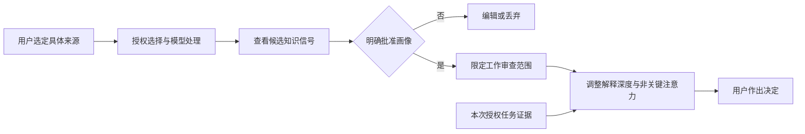

<div align="center">

# MARIS
### AI 高速工作，**你掌握真正重要的部分。**

**Memory-Aware Review & Insight Skill** · 面向 AI Agent 的认知协同与人工监督

从复杂产出中找出需要理解、验证和决定的关键事项；在获得授权后，用可校正的认知画像调整解释深度。Flow 模式服务于同一个活动会话，不是后台监视其他 Agent。

[English](README.md) · [中文](README.zh-CN.md) · [ChatGPT 对比](demos/CHATGPT_COMPARISON.md) · [快速开始](#快速开始) · [授权画像](#经授权的认知画像) · [隐私](docs/PRIVACY.md)

[](https://agentskills.io/specification)
[](LICENSE)
[](skills/maris/scripts/profile.py)
[](docs/PRIVACY.md)

</div>

---

> Agent 告诉你“做了什么”；**MARIS 帮你发现哪些必须理解、哪些还缺证据，以及哪些决定应当由你作出。**

## ChatGPT + MARIS：三个任务的工作流对比

**Coding、Research、Decision，每个场景两份完整且认真分析问题的审查。**

| 场景 | ChatGPT 普通审查写法 | 按 MARIS 工作流组织 |
|---|---|---|
| Coding | 指出缺少到期判断，并提出边界测试。 | 将同一发现转为验收节点，明确时间语义和执行授权。 |
| Research | 构造调和扰动反例，否定有限点观测下的唯一性。 | 保留同一证明，并明确论文里哪些结论不能通过、怎样修订。 |
| Decision | 只提出有条件的、可逆的 FMI 探索实验。 | 区分文档声称、评分假设与资源承诺前必须由人确认的决定。 |

[**查看六份全文、共同输入和方法说明 →**](demos/CHATGPT_COMPARISON.md)

> **这是非盲的同会话展示，不是独立 A/B 性能评测。** 当前 ChatGPT 会话的模型标识为 GPT-6 Astra Pro，但会话已接触答案和 MARIS，普通审查不是未接触 Skill 的控制组。没有另行调用 Codex/API，没有导入私人历史，不宣称准确率、速度或学习效果提升；两边均保留核心发现。

普通审查并不被故意简化成流水账。这里展示的是如何组织证据、解释和下一步决策，不是证明 MARIS 找出了普通模型无法发现的问题。严格的独立会话与用户效果评测仍需另行开展。

## 三个案例：理解 · 验证 · 决策

[中文三案例详细报告](demos/README.zh-CN.md) · [English demos](demos/README.md)

| Demo | 任务和证据 | 需要人判断的问题 |
|---|---|---|
| **[Coding：RevAgent](demos/01-coding/README.md)** | 公开历史提交与后续到期策略修复。 | 记录 `30_days` 是否等于真正实施到期清理？ |
| **[Research：Poisson](demos/02-research/README.md)** | 为 Demo 构造的数学问题与精确算术检查。 | 有限个点的观测是否足以证明全局唯一性？ |
| **[Decision：工程软件路线](demos/03-decision/README.md)** | 文档资料台账与明确标为假设的评分。 | 什么用户约束和证据足以支持路线选择？ |

```bash
python demos/run.py --verify
python demos/run.py --case coding   --mode personalized
python demos/run.py --case research --mode personalized
python demos/run.py --case decision --mode personalized
```

这些命令不调用模型。`--verify` 做本地案例检查；`--case ...` 展示原有 Markdown 参考输出。原始 `baseline / cold-start / personalized` 文件与上方新加入的 ChatGPT 同会话展示都不构成独立性能评测。[评测规范](demos/EVALUATION.md)

## 快速开始

从公开仓库安装：

```bash
npx skills add chenyongssss/maris --skill maris
```

`skills.sh` 安装器由第三方维护，可能有自己的安装统计；这与 MARIS 本地脚本没有遥测是两回事。

也可以复制整个 `skills/maris/` 目录到宿主支持的位置，例如 Claude Code 项目中的 `.claude/skills/maris/`，或 Codex 项目中的 `.agents/skills/maris/`。按宿主要求重新加载。

```text
使用 MARIS 审查本次授权的任务材料。
给出最需要理解、验证或决定的事项及对应证据。
不使用历史或画像，不修改文件；运行测试需要我另行授权。
```

调用方式依客户端而异，不要把 `/maris` 当作通用命令。在 ChatGPT 会话中读取 Skill 指令并按其工作流回答，可以用于内容展示；这不等于已经验证原生 Skill 加载、安装和 Codex 端到端兼容性。

**MARIS 不另行提供模型账号。** 仍需使用已配置好的宿主及其正常访问权限。基础审查不要求导入历史或建立数据库；可选本地画像工具需要 Python 3.10+。

## 让 AI 工作时，也能按需介入

```text
接下来在同一个活动会话中使用 MARIS Flow 模式。
继续执行已授权的常规工作；当重要假设、关键验证条件
或需要我批准的操作出现时，给出一个简短决策节点。
不要把沉默视为同意，不读取历史或画像。
```

可选择 `quiet`、`balanced` 或 `learning` 交互强度。这是同一宿主会话遵循的协作规范，不是自动拦截其他 Agent；独立运行时集成还需要专门实现。

## 经授权的认知画像

**默认关闭，绝不静默读取历史聊天。** 用户可以选择具体文件或对话，允许相应处理后形成候选画像，逐项检查、修正，再决定是否保存和复用。



画像可以记录用户确认的熟悉领域、学习目标及审查偏好。频繁提到某主题不代表已经掌握；不得据此推断敏感身份、人格诊断、亲密关系或社交匹配信息。客观关键风险不会因用户“熟悉”而被隐藏。

### 选择性导入

支持用户选定的 ChatGPT `conversations.json` / ZIP 导出，以及 Markdown/TXT 对话文件；没有自动账号访问或全量历史扫描。

```bash
# 只显示目录信息，不输出聊天正文。
python /path/to/skills/maris/scripts/profile.py catalog \
  --input /path/to/conversations.json

# 用户明确选择并授权后，暂存指定对话。
python /path/to/skills/maris/scripts/profile.py stage \
  --input /path/to/conversations.json --indices 2,5 --consent

# 生成候选模板，检查和修改后再批准。
python /path/to/skills/maris/scripts/profile.py template

# 只有明确批准候选画像后才执行。
python /path/to/skills/maris/scripts/profile.py approve \
  --confirm APPROVE-MARIS-PROFILE
```

本地解析脚本不主动联网，但**当宿主 Agent 读取选定片段时，文本可能发往该宿主的模型提供商**。允许本地选择不自动等于允许模型处理。临时片段和画像被 Git 忽略，但并未加密。[数据边界](docs/PRIVACY.md)

没有导出文件也可以直接提供本次任务的说明偏好，不必创建持久画像。

```bash
python /path/to/skills/maris/scripts/profile.py show
python /path/to/skills/maris/scripts/profile.py erase \
  --confirm DELETE-MARIS-LOCAL-DATA
```

删除只涉及当前工作区 MARIS 暂存内容、候选和画像，不删除原始导出、云端历史或提供商日志。

## 工作机制与标记

MARIS 分开处理客观风险与解释需求。前者决定必须审查什么；后者影响如何解释，而不改变事实或验证标准。

| 证据标记 | 含义 |
|---|---|
| `OBSERVED` | 直接检查过的材料，不自动表示正确 |
| `REPORTED` | 他人或资料的声称，本次没有独立确认 |
| `INFERRED` | 基于给定依据的分析，需说明前提与范围 |
| `UNKNOWN` | 证据不足，尚不能判断 |

证据状态与执行状态不同：看过测试日志不等于重跑测试。新展示还区分 `GATE`（阻塞验收）、`FOCUS`（重要审查项）、`CONTEXT`（背景）。`NOT_RUN` 表示相应可执行检查没有运行，不表示没有给出数学推导。

## 使用模式

| 指令 | 效果 |
|---|---|
| `Review this work` | 简短的证据与决策简报 |
| `Use MARIS in flow mode` | 同会话重要决策节点交互 |
| `Use my approved profile` | 在明确授权范围内复用画像 |
| `Build a profile from these selected chats` | 选择、授权、草稿、审核、批准 |
| `Explain #1` | 解释这项决策需要理解的内容 |
| `Verify #2` | 先提出最小验证方案，不自动运行 |
| `Challenge #1` | 检查替代假设、反例与失败条件 |
| `Without my profile` | 不读取画像，照常审查 |

[完整使用规范](docs/USAGE.md)

## 评测与贡献

[ChatGPT 两种工作流展示](demos/CHATGPT_COMPARISON.md) · [原有案例方法](demos/EVALUATION.md) · [评测协议](evals/README.md) · [虚构对话样本](examples/sample-conversations.json) · [贡献指南](CONTRIBUTING.md)

```bash
python -m unittest discover -s tests -v
```

本地测试只能检查文件与工具行为，不能证明独立模型审查准确率、宿主兼容性或用户理解提升。项目不公布编造的胜率、用户数或认证。

**没有内置遥测，没有后台监听，没有自动读取历史，没有静默保存画像；默认只读审查。** 这些是 MARIS 的工作流和脚本边界，不是对所有第三方宿主、安装器或提供商的保证。[安全说明](SECURITY.md)

我们希望验证的不是“再生成一份漂亮报告”，而是让人用更少的注意力理解真正影响验收的决定。欢迎提供脱敏、可复现的案例。

[MIT License](LICENSE)。独立项目，与 OpenAI、Anthropic 等提供商不存在官方隶属关系。
